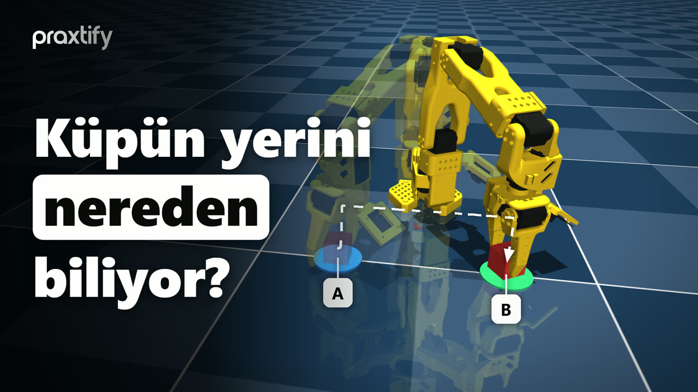
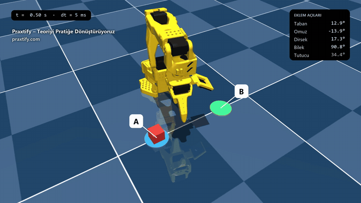
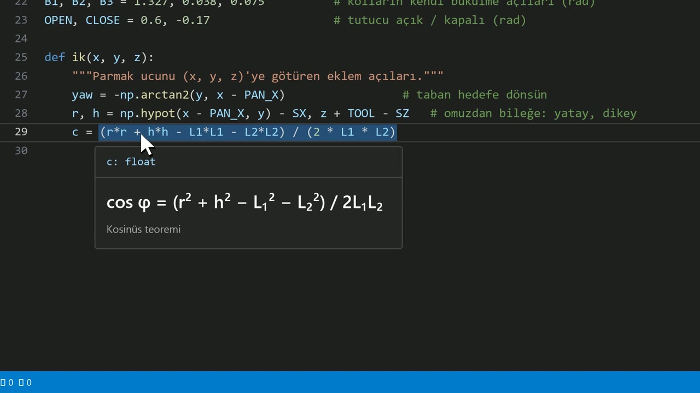
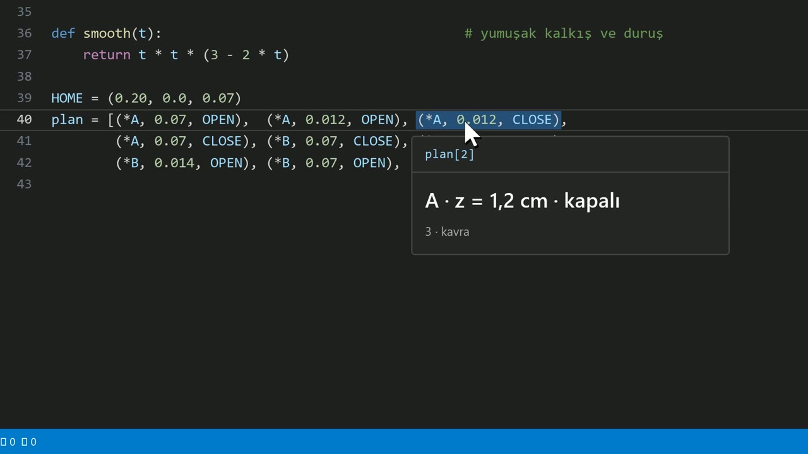

<a id="top"></a>

<div align="center">



### 🇬🇧 [English](#en) &nbsp;·&nbsp; 🇹🇷 [Türkçe](#tr) &nbsp;·&nbsp; 🇩🇪 [Deutsch](#de)

</div>

---

<a id="en"></a>

<div align="center">

🇬🇧 **English** &nbsp;·&nbsp; 🇹🇷 [Türkçe](#tr) &nbsp;·&nbsp; 🇩🇪 [Deutsch](#de)

# Inverse Kinematics Pick-and-Place · MuJoCo + SO101

[](https://www.youtube.com/@praxtify)
[](https://praxtify.com)

**How does a robot arm know where the cube is?** This repo builds, from scratch, a simulation in which the SO101 robot arm
picks a cube up at point A and places it at point B: it solves the inverse kinematics by hand with the law of cosines,
smooths the motion, and runs everything in the **MuJoCo** physics engine with real contact, friction and gravity.

[](https://www.python.org/)
[](https://mujoco.org/)
[](LICENSE)
[](https://www.youtube.com/@praxtify)

</div>

<p align="center">
  
</p>

---

## Contents

- [What you'll learn](#what-youll-learn)
- [Quick start](#quick-start)
- [Project structure](#project-structure)
- [How it works](#how-it-works)
- [Result](#result)
- [Try it yourself](#try-it-yourself)
- [Credits and licenses](#credits-and-licenses)
- [Praxtify](#praxtify)

## What you'll learn

| Topic | In this project |
|---|---|
| Physics engine | Building a scene in MuJoCo, editing it from code with `MjSpec`, the difference between `MjModel` and `MjData` |
| Inverse kinematics | Computing four motor angles from the fingertip's target position with the law of cosines |
| Motion planning | A nine-step pick-and-place task with jerk-free *smoothstep* transitions |
| Simulation loop | At every step: IK → motor command → `mj_step` (5 ms) → screen |

The whole project is **a single file, under 60 lines**: [`pick_and_place.py`](pick_and_place.py). It is identical to the code written line by line in the video.

## Quick start

```bash
git clone https://github.com/praxtify/0-mujoco-ters-kinematik.git
cd 0-mujoco-ters-kinematik

python -m venv .venv
# Windows:      .venv\Scripts\activate
# macOS/Linux:  source .venv/bin/activate
pip install -r requirements.txt

python pick_and_place.py
```

A MuJoCo window opens and the arm completes the task in about 11 seconds.

> [!NOTE]
> - Run the code **from the repo folder**: the robot model is loaded via the relative path `models/…`.
> - **On macOS**, `mujoco.viewer.launch_passive` requires `mjpython pick_and_place.py` instead of `python` (it ships with MuJoCo).
> - Code comments are in Turkish; the explanation below covers every part of the code.
> - Tested with: Python 3.13 · MuJoCo 3.15 · NumPy 2.5 (Windows 11).

## Project structure

```text
0-mujoco-ters-kinematik/
├── pick_and_place.py                       # the whole project: scene + inverse kinematics + task + simulation
├── requirements.txt                        # mujoco, numpy
├── models/
│   └── mujoco_menagerie/robotstudio_so101/ # SO101 robot model (MuJoCo Menagerie, Apache 2.0)
├── docs/                                   # README images
└── LICENSE                                 # MIT (project code)
```

## How it works

### 1 · Scene: robot + cube + markers

The SO101 model is opened as **editable** with `MjSpec`; additions are made to the scene from code, without touching the XML file:

- **Cube:** 3 cm, 30 g, a free joint (it can fall, be pushed and be grasped) and high friction (`friction = 1.5`) so it does not slip out of the gripper.
- **A / B markers:** purely visual discs (`contype = conaffinity = 0`) that take no part in the physics.

`spec.compile()` turns the scene into a **model**: the robot's fixed description. `MjData`, on the other hand, is the **state** that changes at every instant: angles, velocities, forces.

### 2 · Inverse kinematics: from position to joint angles

`ik(x, y, z)` takes the point the fingertip should reach and returns the angles of the four motors.

The **base** turns towards the target:

$$\text{yaw} = -\,\mathrm{atan2}\big(y,\; x - x_{\text{base}}\big)$$

The problem reduces to a plane: the horizontal distance $r$ and the vertical distance $h$ from shoulder to wrist (the gripper length $\text{TOOL}$ is added, because the wrist sits above the fingertip):

$$r = \sqrt{(x - x_{\text{base}})^2 + y^2} - s_x \qquad h = z + \text{TOOL} - s_z$$

The upper arm $L_1 = 11.6$ cm, the forearm $L_2 = 13.5$ cm and the target form a triangle. The **law of cosines** gives the elbow angle;
the minus sign keeps the elbow up:

$$\cos\varphi = \frac{r^2 + h^2 - L_1^2 - L_2^2}{2\,L_1 L_2} \qquad \varphi = -\arccos(\cos\varphi)$$

<p align="center"></p>

The **shoulder** angle is the direction to the target minus the offset caused by the bent elbow:

$$a_1 = \mathrm{atan2}(h, r) - \mathrm{atan2}\big(L_2 \sin\varphi,\; L_1 + L_2 \cos\varphi\big)$$

The real SO101's links are not perfectly straight; `B1, B2, B3` account for these small bends when converting to motor angles.
The **wrist** completes the remaining angle so that the gripper always points straight down (total angle −90°).

### 3 · Smooth motion

Every transition follows the `smoothstep` curve — it starts slowly, speeds up and comes to a gentle stop:

$$s(t) = 3t^2 - 2t^3, \qquad \mathbf{p}(t) = \mathbf{p}_0 + (\mathbf{p}_1 - \mathbf{p}_0)\, s(t)$$

### 4 · Task plan: nine steps

<p align="center"></p>

| # | Step | Position | Gripper |
|:-:|---|---|:-:|
| 1 | Move above A | A, z = 7 cm | open |
| 2 | Descend | A, z = 1.2 cm | open |
| 3 | Grasp | A, z = 1.2 cm | **closed** |
| 4 | Lift | A, z = 7 cm | closed |
| 5 | Carry to B | B, z = 7 cm | closed |
| 6 | Descend | B, z = 1.4 cm | closed |
| 7 | Release | B, z = 1.4 cm | **open** |
| 8 | Move up | B, z = 7 cm | open |
| 9 | Return home | (20, 0, 7) cm | open |

### 5 · Simulation loop

We control time ourselves: each plan step lasts **240 physics steps** (240 × 5 ms = 1.2 s). At every step the target position
advances along `smooth`, the inverse kinematics is solved, the motors receive their target angles (`data.ctrl`) and `mj_step` moves the world 5 ms forward:
contact, friction, gravity. `viewer.sync()` refreshes the screen and `time.sleep` keeps pace with real time.

## Result

The task is completed in **10.8 seconds** of simulation; the cube is placed **4.8 mm** from point B
(measured: `data.body("cube").xpos` → `[0.195, 0.100, 0.015]`). Grasping, lifting and releasing are handled entirely by the physics engine's contact
computation — the cube is never "glued" anywhere.

## Try it yourself

- Change `A` and `B`: find the arm's reachable workspace (what happens when the cosine leaves `[-1, 1]`?).
- Lower `friction` to 0.3: does the cube slip out of the gripper?
- Change `range(240)` to 120: the motion becomes twice as fast — can the cube still be carried?
- Add a new point to the plan: move the cube to a third spot, or stack two cubes.

## Credits and licenses

The **project code** in this repo ([`pick_and_place.py`](pick_and_place.py)) is released under the [MIT license](LICENSE). Third-party parts
come with their own licenses:

| Component | Source | License | In repo |
|---|---|---|---|
| **SO101 robot model** (MJCF + STL) | [MuJoCo Menagerie · `robotstudio_so101`](https://github.com/google-deepmind/mujoco_menagerie/tree/main/robotstudio_so101) — based on The Robot Studio's [SO-ARM100 / SO101](https://github.com/TheRobotStudio/SO-ARM100) design | [Apache 2.0](models/mujoco_menagerie/robotstudio_so101/LICENSE) | ✔ `models/` (unmodified) |
| **MuJoCo** physics engine | [Google DeepMind](https://github.com/google-deepmind/mujoco) | Apache 2.0 | installed via `pip` |
| **NumPy** | [numpy.org](https://numpy.org/) | BSD 3-Clause | installed via `pip` |

The model files were copied from MuJoCo Menagerie **without modification**; for details and change history see the model's own
[README](models/mujoco_menagerie/robotstudio_so101/README.md) and [CHANGELOG](models/mujoco_menagerie/robotstudio_so101/CHANGELOG.md).

## Praxtify

**Turning theory into practice.** We teach robotics, embedded systems and AI step by step, with working code.
For this project's video and new projects:

<p align="center">
  <a href="https://praxtify.com"></a>
  <a href="https://www.youtube.com/@praxtify"></a>
  <a href="https://www.instagram.com/praxtify"></a>
  <a href="https://www.tiktok.com/@praxtify"></a>
  <a href="https://x.com/praxtify"></a>
  <a href="https://www.threads.net/@praxtify"></a>
  <a href="https://www.linkedin.com/company/praxtify"></a>
  <a href="https://www.facebook.com/praxtify"></a>
  <a href="https://www.pinterest.com/praxtify"></a>
</p>

For questions, bugs or suggestions, open an [issue](../../issues). If you like the project, don't forget to give it a ⭐!

**Next project in the series:** [1-arduino-robot-kol](https://github.com/praxtify/1-arduino-robot-kol) — driving this arm with a real Arduino.

<p align="right"><a href="#top">↑ Back to top</a></p>

---

<a id="tr"></a>

<div align="center">

🇬🇧 [English](#en) &nbsp;·&nbsp; 🇹🇷 **Türkçe** &nbsp;·&nbsp; 🇩🇪 [Deutsch](#de)

# Ters Kinematik ile Al-Bırak · MuJoCo + SO101

[](https://www.youtube.com/@praxtify)
[](https://praxtify.com)

**Bir robot kol, küpün yerini nereden bilir?** Bu repo, SO101 robot kolunun bir küpü A noktasından alıp B noktasına bıraktığı
simülasyonu sıfırdan kurar: ters kinematiği kosinüs teoremiyle elle çözer, hareketi yumuşatır ve her şeyi
**MuJoCo** fizik motorunda gerçek temas, sürtünme ve yerçekimiyle çalıştırır.

[](https://www.python.org/)
[](https://mujoco.org/)
[](LICENSE)
[](https://www.youtube.com/@praxtify)

</div>

<p align="center">
  
</p>

---

## İçindekiler

- [Ne öğreneceksin?](#ne-öğreneceksin)
- [Hızlı başlangıç](#hızlı-başlangıç)
- [Proje yapısı](#proje-yapısı)
- [Nasıl çalışıyor?](#nasıl-çalışıyor)
- [Sonuç](#sonuç)
- [Kendin dene](#kendin-dene)
- [Kaynaklar ve lisanslar](#kaynaklar-ve-lisanslar)
- [Praxtify](#praxtify-1)

## Ne öğreneceksin?

| Konu | Bu projede |
|---|---|
| Fizik motoru | MuJoCo ile sahne kurma, `MjSpec` ile sahneyi koddan düzenleme, `MjModel` / `MjData` farkı |
| Ters kinematik | Parmak ucunun hedef konumundan dört motor açısını kosinüs teoremiyle hesaplama |
| Hareket planlama | Dokuz adımlık al-bırak görevi, *smoothstep* ile sarsıntısız geçiş |
| Simülasyon döngüsü | Her adımda IK → motor komutu → `mj_step` (5 ms) → ekran |

Kodun tamamı **tek dosya, 60 satırdan kısa**: [`pick_and_place.py`](pick_and_place.py). Videoda satır satır yazılan kodla birebir aynıdır.

## Hızlı başlangıç

```bash
git clone https://github.com/praxtify/0-mujoco-ters-kinematik.git
cd 0-mujoco-ters-kinematik

python -m venv .venv
# Windows:      .venv\Scripts\activate
# macOS/Linux:  source .venv/bin/activate
pip install -r requirements.txt

python pick_and_place.py
```

MuJoCo penceresi açılır ve kol görevi ~11 saniyede tamamlar.

> [!NOTE]
> - Kodu **repo klasöründen** çalıştır: robot modeli `models/…` göreli yoluyla açılır.
> - **macOS'ta** `mujoco.viewer.launch_passive` için `python` yerine `mjpython pick_and_place.py` kullan (MuJoCo ile birlikte gelir).
> - Test edilen ortam: Python 3.13 · MuJoCo 3.15 · NumPy 2.5 (Windows 11).

## Proje yapısı

```text
0-mujoco-ters-kinematik/
├── pick_and_place.py                       # bütün proje: sahne + ters kinematik + görev + simülasyon
├── requirements.txt                        # mujoco, numpy
├── models/
│   └── mujoco_menagerie/robotstudio_so101/ # SO101 robot modeli (MuJoCo Menagerie, Apache 2.0)
├── docs/                                   # README görselleri
└── LICENSE                                 # MIT (proje kodu)
```

## Nasıl çalışıyor?

### 1 · Sahne: robot + küp + işaretler

SO101 modeli `MjSpec` ile **düzenlenebilir** açılır; XML dosyasına dokunmadan sahneye kodla eklemeler yapılır:

- **Küp:** 3 cm, 30 g, serbest eklem (düşer, itilir, tutulur) ve yüksek sürtünme (`friction = 1.5`) — tutucu kaydırmasın.
- **A / B işaretleri:** yalnız görsel diskler (`contype = conaffinity = 0`), fiziğe karışmaz.

`spec.compile()` sahneyi **model**e çevirir: robotun değişmeyen tarifi. `MjData` ise her an değişen **durum**dur: açılar, hızlar, kuvvetler.

### 2 · Ters kinematik: konumdan eklem açılarına

`ik(x, y, z)` parmak ucunun gideceği noktayı alır, dört motorun açısını döndürür.

**Taban** hedefin yönüne döner:

$$\text{yaw} = -\,\mathrm{atan2}\big(y,\; x - x_{\text{taban}}\big)$$

Problem düzleme iner: omuzdan bileğe yatay uzaklık $r$, dikey uzaklık $h$ (tutucu boyu $\text{TOOL}$ eklenir, çünkü bilek parmak ucunun üstündedir):

$$r = \sqrt{(x - x_{\text{taban}})^2 + y^2} - s_x \qquad h = z + \text{TOOL} - s_z$$

Üst kol $L_1 = 11{,}6$ cm, ön kol $L_2 = 13{,}5$ cm ve hedef bir üçgen kurar. **Kosinüs teoremi** dirsek açısını verir;
eksi işaret dirseği yukarıda tutar:

$$\cos\varphi = \frac{r^2 + h^2 - L_1^2 - L_2^2}{2\,L_1 L_2} \qquad \varphi = -\arccos(\cos\varphi)$$

<p align="center"></p>

**Omuz** açısı, hedefin yönünden dirseğin bükülmesiyle oluşan sapmanın çıkarılmasıdır:

$$a_1 = \mathrm{atan2}(h, r) - \mathrm{atan2}\big(L_2 \sin\varphi,\; L_1 + L_2 \cos\varphi\big)$$

Gerçek SO101'in kolları dümdüz değildir; `B1, B2, B3` bu küçük bükülmeleri motor açısına çevirirken hesaba katar.
**Bilek** kalan açıyı tamamlar, böylece tutucu her zaman dik aşağı bakar (toplam açı −90°).

### 3 · Yumuşak hareket

Her geçiş `smoothstep` eğrisiyle yapılır — yavaş başlar, hızlanır, yumuşakça durur:

$$s(t) = 3t^2 - 2t^3, \qquad \mathbf{p}(t) = \mathbf{p}_0 + (\mathbf{p}_1 - \mathbf{p}_0)\, s(t)$$

### 4 · Görev planı: dokuz adım

<p align="center"></p>

| # | Adım | Konum | Tutucu |
|:-:|---|---|:-:|
| 1 | A'nın üstüne gel | A, z = 7 cm | açık |
| 2 | Aşağı in | A, z = 1,2 cm | açık |
| 3 | Kavra | A, z = 1,2 cm | **kapalı** |
| 4 | Kaldır | A, z = 7 cm | kapalı |
| 5 | B'ye taşı | B, z = 7 cm | kapalı |
| 6 | Aşağı in | B, z = 1,4 cm | kapalı |
| 7 | Bırak | B, z = 1,4 cm | **açık** |
| 8 | Yukarı çık | B, z = 7 cm | açık |
| 9 | Başlangıca dön | (20, 0, 7) cm | açık |

### 5 · Simülasyon döngüsü

Zamanı biz yönetiriz: her plan adımı **240 fizik adımı** (240 × 5 ms = 1,2 s) sürer. Her adımda hedef konum
`smooth` ile ilerler, ters kinematik çözülür, motorlara hedef açı (`data.ctrl`) verilir ve `mj_step` dünyayı 5 ms ileri alır:
temas, sürtünme, yerçekimi. `viewer.sync()` ekranı günceller, `time.sleep` gerçek zamanla eşitler.

## Sonuç

Görev **10,8 saniyelik** simülasyonda tamamlanır; küp B noktasının **4,8 mm** yakınına bırakılır
(ölçüm: `data.body("cube").xpos` → `[0.195, 0.100, 0.015]`). Tutma, kaldırma ve bırakma tamamen fizik motorunun temas
hesabıyla olur — küp hiçbir yerde "yapıştırılmaz".

## Kendin dene

- `A` ve `B`'yi değiştir: kolun erişebildiği alanı bul (kosinüs `[-1, 1]` dışına çıkınca ne olur?).
- `friction` değerini 0,3'e indir: küp tutucudan kayıyor mu?
- `range(240)`'ı 120 yap: hareket iki kat hızlanır — küp hâlâ taşınabiliyor mu?
- Plana yeni bir nokta ekle: küpü üçüncü bir yere, ya da üst üste iki küp diz.

## Kaynaklar ve lisanslar

Bu repodaki **proje kodu** ([`pick_and_place.py`](pick_and_place.py)) [MIT lisansı](LICENSE) ile yayımlanır. Üçüncü taraf parçalar
kendi lisanslarıyla gelir:

| Bileşen | Kaynak | Lisans | Repoda |
|---|---|---|---|
| **SO101 robot modeli** (MJCF + STL) | [MuJoCo Menagerie · `robotstudio_so101`](https://github.com/google-deepmind/mujoco_menagerie/tree/main/robotstudio_so101) — The Robot Studio'nun [SO-ARM100 / SO101](https://github.com/TheRobotStudio/SO-ARM100) tasarımından | [Apache 2.0](models/mujoco_menagerie/robotstudio_so101/LICENSE) | ✔ `models/` (değiştirilmeden) |
| **MuJoCo** fizik motoru | [Google DeepMind](https://github.com/google-deepmind/mujoco) | Apache 2.0 | `pip` ile kurulur |
| **NumPy** | [numpy.org](https://numpy.org/) | BSD 3-Clause | `pip` ile kurulur |

Model dosyaları MuJoCo Menagerie'den **değiştirilmeden** kopyalanmıştır; ayrıntılar ve değişiklik geçmişi için
modelin kendi [README](models/mujoco_menagerie/robotstudio_so101/README.md) ve [CHANGELOG](models/mujoco_menagerie/robotstudio_so101/CHANGELOG.md) dosyalarına bakın.

## Praxtify

**Teoriyi pratiğe dönüştürüyoruz.** Robotik, gömülü sistemler ve yapay zekâyı çalışan kodla, adım adım anlatıyoruz.
Bu projenin videosu ve yeni projeler için:

<p align="center">
  <a href="https://praxtify.com"></a>
  <a href="https://www.youtube.com/@praxtify"></a>
  <a href="https://www.instagram.com/praxtify"></a>
  <a href="https://www.tiktok.com/@praxtify"></a>
  <a href="https://x.com/praxtify"></a>
  <a href="https://www.threads.net/@praxtify"></a>
  <a href="https://www.linkedin.com/company/praxtify"></a>
  <a href="https://www.facebook.com/praxtify"></a>
  <a href="https://www.pinterest.com/praxtify"></a>
</p>

Soru, hata ya da öneri için bir [issue](../../issues) aç. Projeyi beğendiysen ⭐ vermeyi unutma!

**Serinin sıradaki projesi:** [1-arduino-robot-kol](https://github.com/praxtify/1-arduino-robot-kol) — bu kolu gerçek bir Arduino ile yönetiyoruz.

<p align="right"><a href="#top">↑ Başa dön</a></p>

---

<a id="de"></a>

<div align="center">

🇬🇧 [English](#en) &nbsp;·&nbsp; 🇹🇷 [Türkçe](#tr) &nbsp;·&nbsp; 🇩🇪 **Deutsch**

# Pick-and-Place mit inverser Kinematik · MuJoCo + SO101

[](https://www.youtube.com/@praxtify)
[](https://praxtify.com)

**Woher weiß ein Roboterarm, wo der Würfel liegt?** Dieses Repo baut von Grund auf eine Simulation, in der der Roboterarm SO101
einen Würfel an Punkt A greift und an Punkt B ablegt: Die inverse Kinematik wird von Hand mit dem Kosinussatz gelöst,
die Bewegung wird geglättet, und alles läuft in der Physik-Engine **MuJoCo** mit echtem Kontakt, Reibung und Schwerkraft.

[](https://www.python.org/)
[](https://mujoco.org/)
[](LICENSE)
[](https://www.youtube.com/@praxtify)

</div>

<p align="center">
  
</p>

---

## Inhalt

- [Was du lernst](#was-du-lernst)
- [Schnellstart](#schnellstart)
- [Projektstruktur](#projektstruktur)
- [So funktioniert es](#so-funktioniert-es)
- [Ergebnis](#ergebnis)
- [Probier es selbst](#probier-es-selbst)
- [Quellen und Lizenzen](#quellen-und-lizenzen)
- [Praxtify](#praxtify-2)

## Was du lernst

| Thema | In diesem Projekt |
|---|---|
| Physik-Engine | Eine Szene in MuJoCo aufbauen, sie mit `MjSpec` per Code bearbeiten, der Unterschied zwischen `MjModel` und `MjData` |
| Inverse Kinematik | Die vier Motorwinkel aus der Zielposition der Fingerspitze mit dem Kosinussatz berechnen |
| Bewegungsplanung | Eine Pick-and-Place-Aufgabe in neun Schritten mit ruckfreien *Smoothstep*-Übergängen |
| Simulationsschleife | In jedem Schritt: IK → Motorbefehl → `mj_step` (5 ms) → Bildschirm |

Das gesamte Projekt ist **eine einzige Datei mit weniger als 60 Zeilen**: [`pick_and_place.py`](pick_and_place.py). Sie ist identisch mit dem Code, der im Video Zeile für Zeile geschrieben wird.

## Schnellstart

```bash
git clone https://github.com/praxtify/0-mujoco-ters-kinematik.git
cd 0-mujoco-ters-kinematik

python -m venv .venv
# Windows:      .venv\Scripts\activate
# macOS/Linux:  source .venv/bin/activate
pip install -r requirements.txt

python pick_and_place.py
```

Ein MuJoCo-Fenster öffnet sich, und der Arm erledigt die Aufgabe in etwa 11 Sekunden.

> [!NOTE]
> - Starte den Code **aus dem Repo-Ordner**: Das Robotermodell wird über den relativen Pfad `models/…` geladen.
> - **Unter macOS** braucht `mujoco.viewer.launch_passive` statt `python` den Befehl `mjpython pick_and_place.py` (wird mit MuJoCo installiert).
> - Die Code-Kommentare sind auf Türkisch; die Erklärung unten deckt jeden Teil des Codes ab.
> - Getestet mit: Python 3.13 · MuJoCo 3.15 · NumPy 2.5 (Windows 11).

## Projektstruktur

```text
0-mujoco-ters-kinematik/
├── pick_and_place.py                       # das ganze Projekt: Szene + inverse Kinematik + Aufgabe + Simulation
├── requirements.txt                        # mujoco, numpy
├── models/
│   └── mujoco_menagerie/robotstudio_so101/ # SO101-Robotermodell (MuJoCo Menagerie, Apache 2.0)
├── docs/                                   # Bilder für die README
└── LICENSE                                 # MIT (Projektcode)
```

## So funktioniert es

### 1 · Szene: Roboter + Würfel + Markierungen

Das SO101-Modell wird mit `MjSpec` **bearbeitbar** geöffnet; die Szene wird per Code ergänzt, ohne die XML-Datei anzufassen:

- **Würfel:** 3 cm, 30 g, ein freies Gelenk (er kann fallen, geschoben und gegriffen werden) und hohe Reibung (`friction = 1.5`), damit er nicht aus dem Greifer rutscht.
- **Markierungen A / B:** rein visuelle Scheiben (`contype = conaffinity = 0`), die nicht an der Physik teilnehmen.

`spec.compile()` macht aus der Szene ein **Modell**: die unveränderliche Beschreibung des Roboters. `MjData` dagegen ist der **Zustand**, der sich in jedem Moment ändert: Winkel, Geschwindigkeiten, Kräfte.

### 2 · Inverse Kinematik: von der Position zu den Gelenkwinkeln

`ik(x, y, z)` nimmt den Punkt, den die Fingerspitze erreichen soll, und gibt die Winkel der vier Motoren zurück.

Die **Basis** dreht sich zum Ziel:

$$\text{yaw} = -\,\mathrm{atan2}\big(y,\; x - x_{\text{Basis}}\big)$$

Das Problem reduziert sich auf eine Ebene: der horizontale Abstand $r$ und der vertikale Abstand $h$ von der Schulter zum Handgelenk (die Greiferlänge $\text{TOOL}$ wird addiert, weil das Handgelenk über der Fingerspitze liegt):

$$r = \sqrt{(x - x_{\text{Basis}})^2 + y^2} - s_x \qquad h = z + \text{TOOL} - s_z$$

Oberarm $L_1 = 11{,}6$ cm, Unterarm $L_2 = 13{,}5$ cm und das Ziel bilden ein Dreieck. Der **Kosinussatz** liefert den Ellbogenwinkel;
das Minuszeichen hält den Ellbogen oben:

$$\cos\varphi = \frac{r^2 + h^2 - L_1^2 - L_2^2}{2\,L_1 L_2} \qquad \varphi = -\arccos(\cos\varphi)$$

<p align="center"></p>

Der **Schulter**winkel ist die Richtung zum Ziel minus die Abweichung, die durch den gebeugten Ellbogen entsteht:

$$a_1 = \mathrm{atan2}(h, r) - \mathrm{atan2}\big(L_2 \sin\varphi,\; L_1 + L_2 \cos\varphi\big)$$

Die Glieder des echten SO101 sind nicht völlig gerade; `B1, B2, B3` berücksichtigen diese kleinen Knicke bei der Umrechnung in Motorwinkel.
Das **Handgelenk** ergänzt den restlichen Winkel, sodass der Greifer immer senkrecht nach unten zeigt (Gesamtwinkel −90°).

### 3 · Weiche Bewegung

Jeder Übergang folgt der `smoothstep`-Kurve: Er beginnt langsam, beschleunigt und kommt sanft zum Stehen:

$$s(t) = 3t^2 - 2t^3, \qquad \mathbf{p}(t) = \mathbf{p}_0 + (\mathbf{p}_1 - \mathbf{p}_0)\, s(t)$$

### 4 · Aufgabenplan: neun Schritte

<p align="center"></p>

| # | Schritt | Position | Greifer |
|:-:|---|---|:-:|
| 1 | Über A fahren | A, z = 7 cm | offen |
| 2 | Absenken | A, z = 1,2 cm | offen |
| 3 | Greifen | A, z = 1,2 cm | **geschlossen** |
| 4 | Anheben | A, z = 7 cm | geschlossen |
| 5 | Nach B tragen | B, z = 7 cm | geschlossen |
| 6 | Absenken | B, z = 1,4 cm | geschlossen |
| 7 | Loslassen | B, z = 1,4 cm | **offen** |
| 8 | Hochfahren | B, z = 7 cm | offen |
| 9 | Zur Startposition | (20, 0, 7) cm | offen |

### 5 · Simulationsschleife

Die Zeit steuern wir selbst: Jeder Planschritt dauert **240 Physikschritte** (240 × 5 ms = 1,2 s). In jedem Schritt rückt die Zielposition
entlang `smooth` vor, die inverse Kinematik wird gelöst, die Motoren erhalten ihre Zielwinkel (`data.ctrl`), und `mj_step` bewegt die Welt 5 ms weiter:
Kontakt, Reibung, Schwerkraft. `viewer.sync()` aktualisiert den Bildschirm, `time.sleep` hält Schritt mit der Echtzeit.

## Ergebnis

Die Aufgabe ist nach **10,8 Sekunden** Simulationszeit erledigt; der Würfel landet **4,8 mm** neben Punkt B
(gemessen: `data.body("cube").xpos` → `[0.195, 0.100, 0.015]`). Greifen, Anheben und Loslassen entstehen allein aus der Kontaktberechnung
der Physik-Engine — der Würfel wird nirgends „festgeklebt“.

## Probier es selbst

- Ändere `A` und `B`: Finde den Arbeitsraum des Arms (was passiert, wenn der Kosinus `[-1, 1]` verlässt?).
- Senke `friction` auf 0,3: Rutscht der Würfel aus dem Greifer?
- Ändere `range(240)` auf 120: Die Bewegung wird doppelt so schnell — lässt sich der Würfel noch tragen?
- Füge dem Plan einen neuen Punkt hinzu: Bring den Würfel an eine dritte Stelle oder staple zwei Würfel.

## Quellen und Lizenzen

Der **Projektcode** in diesem Repo ([`pick_and_place.py`](pick_and_place.py)) steht unter der [MIT-Lizenz](LICENSE). Teile von Drittanbietern
haben ihre eigenen Lizenzen:

| Komponente | Quelle | Lizenz | Im Repo |
|---|---|---|---|
| **SO101-Robotermodell** (MJCF + STL) | [MuJoCo Menagerie · `robotstudio_so101`](https://github.com/google-deepmind/mujoco_menagerie/tree/main/robotstudio_so101) — basierend auf dem [SO-ARM100 / SO101](https://github.com/TheRobotStudio/SO-ARM100)-Design von The Robot Studio | [Apache 2.0](models/mujoco_menagerie/robotstudio_so101/LICENSE) | ✔ `models/` (unverändert) |
| **MuJoCo** Physik-Engine | [Google DeepMind](https://github.com/google-deepmind/mujoco) | Apache 2.0 | per `pip` installiert |
| **NumPy** | [numpy.org](https://numpy.org/) | BSD 3-Clause | per `pip` installiert |

Die Modelldateien wurden **unverändert** aus MuJoCo Menagerie übernommen; Details und Änderungsverlauf findest du in der
[README](models/mujoco_menagerie/robotstudio_so101/README.md) und im [CHANGELOG](models/mujoco_menagerie/robotstudio_so101/CHANGELOG.md) des Modells.

## Praxtify

**Wir machen aus Theorie Praxis.** Wir erklären Robotik, eingebettete Systeme und KI Schritt für Schritt mit funktionierendem Code.
Für das Video zu diesem Projekt und neue Projekte:

<p align="center">
  <a href="https://praxtify.com"></a>
  <a href="https://www.youtube.com/@praxtify"></a>
  <a href="https://www.instagram.com/praxtify"></a>
  <a href="https://www.tiktok.com/@praxtify"></a>
  <a href="https://x.com/praxtify"></a>
  <a href="https://www.threads.net/@praxtify"></a>
  <a href="https://www.linkedin.com/company/praxtify"></a>
  <a href="https://www.facebook.com/praxtify"></a>
  <a href="https://www.pinterest.com/praxtify"></a>
</p>

Für Fragen, Fehler oder Vorschläge eröffne ein [Issue](../../issues). Wenn dir das Projekt gefällt, vergiss den ⭐ nicht!

**Nächstes Projekt der Serie:** [1-arduino-robot-kol](https://github.com/praxtify/1-arduino-robot-kol) — wir steuern diesen Arm mit einem echten Arduino.

<p align="right"><a href="#top">↑ Nach oben</a></p>
